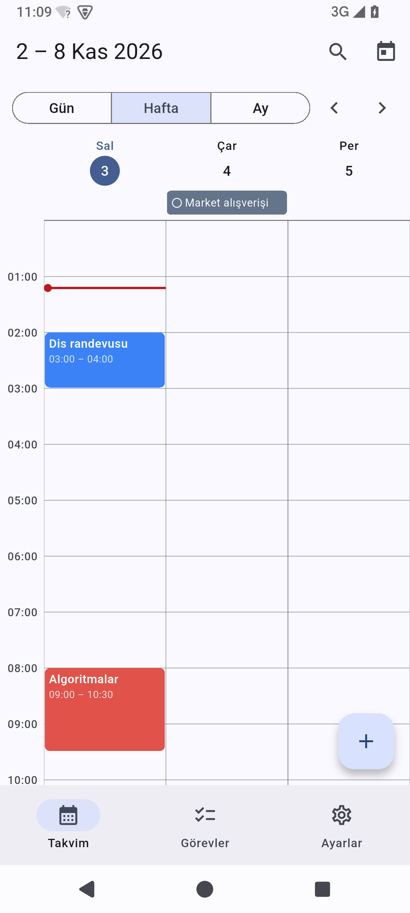
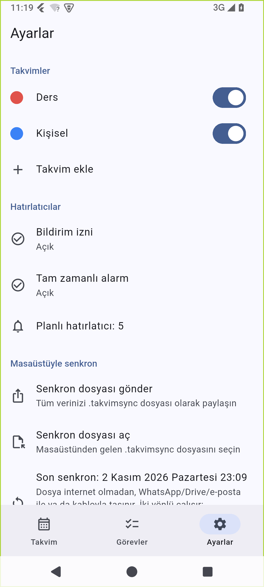

# Takvim (Android)

> **Takvim (Android)** is an offline, account-free calendar and to-do app for Android, the
> phone companion of the desktop [Takvim](https://github.com/tungarix/takvim). No server, no cloud;
> it syncs with the desktop app through a `.takvimsync` file you carry yourself, or directly over the
> same Wi-Fi network. `INTERNET` is used only for that and for the optional update check (off until you choose it).
> Turkish UI, sideload-only (APK).
> Built with Flutter.
> Download the APK from [Releases](https://github.com/tungarix/takvim-mobil/releases).

> **Durum:** Erken erişim (0.x), son sürüm 0.3.0 · **Platform:** Android (telefon öncelikli, tablet de çalışır) ·
> **Lisans:** MIT · **İndir:** [Son sürüm](https://github.com/tungarix/takvim-mobil/releases/latest) ·
> **Site:** [aktenak.tech](https://aktenak.tech)

<p>
  
  
</p>

Hesapsız, bulutsuz, sunucusuz. `INTERNET` izni yalnız iki şey için var: aynı Wi-Fi ağındaki masaüstüyle
**Wi-Fi ile eşleştirme** ve **isteğe bağlı güncelleme denetimi** (ikisi de aşağıda). İkisi de kullanılmıyorken
hiçbir ağ isteği yapılmaz; güncelleme denetimi sen "evet" demeden hiç çalışmaz.
Gün / hafta / ay
görünümü, görevler, tekrarlı etkinlikler, hatırlatıcılar ve arama var. Verilerin yalnız bu telefonda tutulur
(`allowBackup=false`: bulut yedeğine de gitmez). Masaüstü Takvim ile `.takvimsync` dosyası aktararak ya da
aynı Wi-Fi'da QR ile eşleşerek senkron çalışır.

## Kurulum (APK)

1. [Releases](https://github.com/tungarix/takvim-mobil/releases) sayfasından `Takvim-X.Y.Z.apk`
   dosyasını telefonuna indir. İstersen aşağıdaki "İndirmeyi doğrula" adımlarını uygula.
2. Dosyaya dokun. Android "bilinmeyen kaynaklardan yükleme" izni isterse, tarayıcına/dosya yöneticine
   bu izni ver ve kurulumu onayla (Play Protect "tanınmayan uygulama" diyebilir: APK Google Play'de
   yayımlanmıyor, **Yine de yükle**).
3. İlk hatırlatıcıyı eklediğinde **bildirim** izni istenir (Android 13+). Android 12'de tam zamanlı alarm
   için Ayarlar'dan "Alarmlar ve hatırlatıcılar" iznini vermen gerekebilir; vermezsen bildirimler
   yaklaşık zamanda gelir ve Ayarlar'da uyarı görünür.

Tek APK tüm işlemci türlerini içerir (arm64-v8a, armeabi-v7a, x86_64): telefon ve emülatör aynı dosyayı kurar.
Güncelleme için yeni APK'yı eskisinin üstüne kurman yeterli (aynı anahtarla imzalı, veri korunur).

### İndirmeyi doğrula

Her sürüm GitHub Actions'ta derlenir; ekinde `SHA256SUMS.txt` ve bir build provenance attestation'ı vardır.

```powershell
# 1) Özet: SHA256SUMS.txt'deki değerle aynı olmalı
Get-FileHash .\Takvim-0.3.0.apk -Algorithm SHA256

# 2) Dosyanın bu depodan, bu iş akışıyla derlendiği (GitHub CLI gerekir)
gh attestation verify .\Takvim-0.3.0.apk -R tungarix/takvim-mobil

# 3) İmza sertifikası (Android SDK build-tools'taki apksigner)
apksigner verify --print-certs Takvim-0.3.0.apk
```

Sertifika SHA-256 parmak izi, her sürümde aynı olmalı:

```
SHA256: 5F:34:E5:EA:47:46:F3:55:E6:9D:9A:77:E5:91:EA:EF:29:04:70:34:DD:C5:7C:3F:3E:4B:02:AB:6B:83:71:14
```

Parmak izi değişirse APK'yı kurma ve [issue aç](https://github.com/tungarix/takvim-mobil/issues).
Güvenlik sorunu bildirimi için [SECURITY.md](SECURITY.md).

## Masaüstüyle senkron

Ayarlar > **Masaüstüyle senkron**:

1. **Senkron dosyası gönder**: tam durum `takvim-YYYYMMDD-SSDD.takvimsync` olarak sistem Paylaş
   menüsüne gider (WhatsApp, Drive, e-posta, kablo...). Masaüstünde bu dosyayı içe aktarın.
2. **Senkron dosyası aç**: dosya seçicisinden `.takvimsync` seçin. Ya da dosya yöneticisinde /
   WhatsApp'ta / Drive'da dosyaya dokunun ve **Takvim**'i seçin.
3. Önce **önizleme** çıkar ("N etkinlik, M görev, K silme; mevcut veriyle birleşecek"), onaylarsanız
   içe aktarılır ve sonuç özeti gösterilir.

Birleştirme güvenlidir: yalnızca daha yeni kayıtlar uygulanır, aynı dosya ikinci kez açılırsa değişen
bir şey olmaz. Bozuk dosya ya da uygulamadan yeni bir sürümle yazılmış dosya anlaşılır bir mesajla
reddedilir ve veri hiç değişmez. Dosya biçimi ve birleştirme kuralları masaüstü deposundaki
[`docs/senkron.md`](https://github.com/tungarix/takvim/blob/master/docs/senkron.md) belgesindedir.

> **Not:** Masaüstü tarafı, Takvim **1.8.0** ve sonrasında Ayarlar > "Telefonla senkron" bölümündedir (1.8.0 yalnız dosya ile senkron eder). **Wi-Fi ile eşleştirme** masaüstü Takvim **1.9.0** ve sonrasını ister. Daha eski masaüstü sürümleri `.takvimsync` dosyasını tanımaz.

Yalnızca güvendiğin kaynaktan gelen `.takvimsync` dosyalarını aç: dosya içe aktarmadan önce
doğrulanır ve senin onayını bekler, ama içe aktarılan kayıtlar mevcut verinle birleşir.

## Wi-Fi ile eşleştirme (aynı ağdaki masaüstüyle doğrudan senkron)

Dosya taşımadan, telefon ve bilgisayar **aynı Wi-Fi ağındayken** (masaüstü Takvim **1.9.0** ya da sonrası gerekir; 1.8.0 yalnız dosya ile senkron eder):

1. Bilgisayarda Takvim > Ayarlar > Telefonla senkron > **"Wi-Fi ile eşleştir"**: QR kod ve aynı bağlantının
   metni çıkar (en çok 3 dakika geçerli).
2. Telefonun **kamera uygulamasıyla** QR'ı okut ve açılan bağlantıyı Takvim ile aç. Uygulamada QR tarayıcı
   yok (kamera izni de yok). Bağlantı açılmazsa Ayarlar > Masaüstüyle senkron > **Wi-Fi ile eşleştir**
   sayfasındaki alana bağlantı metnini yapıştır.
3. **1. onay:** "«bilgisayar adı» (IP) ile eşleşilecek" ekranı. Bunu bilgisayarındaki eşleştirme ekranından
   aldıysan **Bağlan**. Onaylamadan ağ isteği yapılmaz.
4. Takvim bilgisayarın durumunu alır ve **önizleme** gösterir. **2. onay: "Birleştir ve gönder"**: değişiklikler
   telefona işlenir, ardından telefonun tam durumu bilgisayara gönderilir; bilgisayar da kendi ekranında onay
   ister. Vazgeçersen hiçbir veri gönderilmez ve telefon verisi değişmez.
5. İki rapor gösterilir (telefona / bilgisayara: eklenen, güncellenen, silinen, atlanan). Bildirimler yeniden
   kurulur, "Son senkron" güncellenir.

Protokol ve tehdit modeli masaüstü deposunda:
[`docs/senkron-wifi.md`](https://github.com/tungarix/takvim/blob/master/docs/senkron-wifi.md).

**İnternet izni neden var, ne yapıyor?** `INTERNET` izni (Android'de yerel ağ bağlantısı da bu izne bağlıdır)
yalnız bu özellik için eklendi. Yalnız sen bir eşleştirme bağlantısını onaylayınca, o bağlantıdaki **özel/yerel
IPv4** adrese (10/8, 172.16/12, 192.168/16, 169.254/16) HTTPS ile bağlanır; genel IP, IPv6 ve ana makine
adları reddedilir, iki kez denetlenir. Özellik kullanılmıyorken hiçbir ağ isteği yoktur; telemetri, bulut yok
(güncelleme denetimi ayrı ve isteğe bağlıdır: aşağıdaki "Güncellemeler"). Düz HTTP kapalıdır (`usesCleartextTraffic=false`). Bağlantı, masaüstünün o oturum için
ürettiği kendi imzalı sertifikanın **SHA-256 parmak iziyle sabitlenir** (sistem güven deposuna güvenilmez,
parmak izi uyuşmazsa bağlantı kesilir ve güvenlik uyarısı çıkar), TLS 1.2+ şart, kimlik 128 bit tek kullanımlık
token'dır. `https://aktenak.tech/s` bağlantısı için bir Android App Link filtresi vardır; bağlantı uygulamayı
yalnız **onay ekranına** götürür, kendiliğinden bağlanmaz.

Çalışmazsa: aynı Wi-Fi'da olduğunu, bilgisayardaki eşleştirme ekranının hâlâ açık olduğunu ve ağın cihazları
birbirinden ayırmadığını (misafir ağlar bunu yapabilir) kontrol et. **Yedek yol** her zaman dosya aktarmadır
(yukarıdaki "Masaüstüyle senkron").

## Güncellemeler (isteğe bağlı)

İlk açılışta bir kez **"Yeni sürümler otomatik denetlensin mi?"** diye sorulur; bu soruyu yanıtlamadan ağ isteği
yapılmaz (geri tuşu soruyu kapatmaz); "Ayarlar → Şimdi denetle" ise senin kendi isteğindir ve her zaman çalışır. **Evet** dersen Takvim günde en çok bir kez yalnızca GitHub'a
(`api.github.com/repos/tungarix/takvim-mobil/releases/latest`) "son sürüm nedir" diye sorar; hesap, kimlik ya da
veri göndermez. Yeni sürüm varsa Ayarlar → Güncellemeler'de görünür ve **kurmadan önce her zaman sana sorar**.

- İndirme varsayılan olarak **yalnız Wi-Fi'da**; mobil/ölçülü ağda ayrıca onay istenir.
- APK'nın SHA-256'sı yayındaki `SHA256SUMS.txt`'le eşleşmezse kurulum iptal olur ve dosya silinir.
- Kurulumu sistemin kendi penceresi yapar. Android, **farklı anahtarla imzalı bir APK'yı asla kurmaz**: asıl
  koruma budur (imza anahtarı kaybedilirse güncelleme zinciri kopar). Başka bir uygulama kurulmaz.
- Android "Bu kaynaktan yüklemeye izin ver" ayarını ister; uygulama seni o ekrana götürür.
- Yeni izinler: `REQUEST_INSTALL_PACKAGES` (yalnız bu kurulum için) ve `ACCESS_NETWORK_STATE` (ağın Wi-Fi mi mobil
  veri mi olduğunu anlamak için).
- **Bilinen sınır:** `SHA256SUMS.txt` APK ile aynı yayında durur; GitHub hesabı ya da imza anahtarı ele geçirilirse
  hash tek başına koruma değildir (saldırgan ikisini de üretir, Android da imzayı geçerli sayar). Kurulum sonucu
  (ör. farklı imza nedeniyle reddedilme) ekranda bildirilir.
- Bu özellikten önceki sürümler (≤ 0.3.0) ilk güncellemeyi bir kez elle yapar.

## Sürüm notları

- **0.3.0**: aynı Wi-Fi'daki masaüstü Takvim 1.9.0+ ile **Wi-Fi eşleştirme** (QR ya da bağlantı metni, iki onay,
  sertifika parmak iziyle sabitlenmiş HTTPS; yedek yol hâlâ dosya aktarma). Yeni izin: yalnız `INTERNET`.
  Güvenlik incelemesi: [`guvenlik/incelemeler/v0.3.0.md`](guvenlik/incelemeler/v0.3.0.md).
- **0.2.0**: ilk yayımlanan sürüm (dosya ile senkron, hatırlatıcılar, gün/hafta/ay görünümü, görevler).

## Özellikler

- Material 3, sistem açık/koyu temasını izler; telefon dikey öncelikli, tablet de çalışır.
- Alt gezinme: **Takvim** (Gün / Hafta / Ay), **Görevler**, **Ayarlar**.
- Gün ve hafta saat ızgarası (çakışanlar yan yana, tüm gün şeridi, şimdi çizgisi), ay görünümü
  (telefonda noktalar, geniş ekranda başlıklı şeritler). Boş saate dokununca o saatte yeni etkinlik.
- Etkinlik: başlık, takvim, tüm gün, başlangıç/bitiş, konum, açıklama, tekrar (her gün/hafta/ay/yıl,
  hafta günleri, bitiş: hiç/tarih/n kez), çoklu hatırlatıcı. Tekrarlı etkinlikte sil/düzenle:
  **yalnız bu** (override), **bu ve sonrakiler** (seri bölme), **tümü**. Silmede tek adım geri al.
- Görevler: plansız / bugün / planlı; satır içi ekleme, tamamlama, düzenleme, güne ya da saate
  planlama (saate planlanan görev takvimde zaman bloğu olur), silme (geri alınabilir).
- Takvimler: ekle, yeniden adlandır, renk, görünür/gizli, sil (içindeki etkinlikler de gider).
  İlk açılışta varsayılan "Kişisel" takvimi oluşur (senkronda ad eşleşmesi buna bağlı).
- Arama: etkinlik başlığı/açıklaması/konumu ve görevler; Türkçe harfler katlanır ("carsamba" = "Çarşamba").
- Hatırlatıcılar: yerel bildirim; önümüzdeki 14 gün ve en çok 60 bildirim planlanır, her veri
  değişiminde, açılışta ve arka plandan dönüşte yeniden kurulur, cihaz yeniden başlayınca da yeniden kurulur.

## Derleme

Gereksinimler: Flutter 3.47 (sabit sürüm `release.yml`'de), JDK 17+, Android SDK (platform 36,
build-tools 36.0.0), Android cihaz ya da emülatör.

    flutter pub get
    flutter analyze
    flutter test
    flutter run                      # bağlı cihaz/emülatör
    flutter build apk --debug
    flutter build apk --release      # yerelde debug anahtarıyla imzalanır: yalnız deneme için

Gerçek bir NDK'sı olmayan makinede (yalnız `source.properties` olan sahte NDK klasörü gibi) sembol
soyma adımı çöker; bu durumda `TAKVIM_YEREL_NDKSIZ=1` verilir (APK soyulmadığı için ~170 MB olur):

    TAKVIM_YEREL_NDKSIZ=1 flutter build apk --release                     # bash
    $env:TAKVIM_YEREL_NDKSIZ='1'; flutter build apk --release             # PowerShell

NDK'lı makinede ve CI'da değişken verilmez; APK ~20-60 MB olur.

**Yayımlanan APK yalnız GitHub Actions'ta (`release.yml`) derlenir ve sürüm anahtarıyla imzalanır.**
Anahtar depoda değil, secret'larda (`TAKVIM_KEYSTORE_BASE64`, `TAKVIM_KEYSTORE_PASSWORD`); bir kez
`scripts/imza_anahtari_olustur.ps1` ile oluşturuldu, yedeği depo dışında. Yerelde `TAKVIM_KEYSTORE`
ve `TAKVIM_KEYSTORE_PASSWORD` verilmezse debug anahtarı kullanılır.

Sürüm çıkarma sırası ve güvenlik incelemesi: [`guvenlik/incelemeler/README.md`](guvenlik/incelemeler/README.md).
İncelemesi kayıtlı olmayan sürüm derlenmez; kayıtsız yayımlanan release taslağa geri çekilir.

Sürüm tek yerde: `lib/surum.dart` (`test/cekirdek_ek_test.dart` bunun `pubspec.yaml` ile aynı olduğunu doğrular).

## Masaüstü <-> mobil uçtan uca doğrulama

Tek komut (mobil kökünden; `dart` PATH'te ve masaüstü deposunda `.venv` kurulu olmalı):

    powershell -File tool/e2e/calistir.ps1                  # her şey (~30 sn)
    powershell -File tool/e2e/calistir.ps1 -Senaryo a,f     # seçili senaryolar: a,b,c,d,e,olcek,f,wifi
    powershell -File tool/e2e/calistir.ps1 -Senaryo wifi    # yalnız Wi-Fi eşleştirme uçtan uca (~2 dk)

Masaüstü kodu (`takvim/senkron`, `takvim/store`) GEÇİCİ SQLite dosyasıyla, mobil kodu (`lib/core`,
`lib/sync`, `lib/store`) GEÇİCİ JSON deposuyla sürülür (`tool/e2e/mobil_sunucu.dart`); ikisinin
arasında yalnızca `.takvimsync` dosyaları geçer. Gerçek `%LOCALAPPDATA%` veritabanına ve telefon
verisine dokunulmaz. `flutter test` kullanılmaz.

Mobil saati gerçek saatten `ofset(saniye)` ile kaydırılabilir (masaüstü SQLite tetikleyicileriyle gerçek
saati kullanır): "mobil sonra düzenledi" = +600 sn, "masaüstü sonra" = -600 sn.

Senaryolar (her biri iki cihazın dosya olarak dışa aktarılan TAM durumunu karşılaştırır: takvim/etkinlik/görev
uid kümeleri, bütün alanlar, silinenler, ve tekrar açılımı pencereleri):

- **a** masaüstünde başla (tekrarlı + override + hatırlatıcı + görev + saat planlı görev) -> mobil ->
  mobilde düzenle/tamamla/sil/ekle -> masaüstü -> ikinci dalga -> eşit.
- **b** LWW iki yön ve iki içe aktarma sırası; düzenle-vs-sil (etkinlik/görev, iki yön, iki zaman sırası);
  takvim silme (CASCADE, yetim etkinlik, eski silme); silip geri al.
- **c** iki cihazda bağımsız "Kişisel" takvimi ad eşleşmesiyle birleşir (sırayla ve eşzamanlı çapraz dosya), çift takvim olmaz.
- **d** aynı dosyayı iki kez içe aktar (değişiklik yok, depo birebir aynı), ping-pong ve silme yankısı yok.
- **e** Türkçe/emoji, tzid çeşitleri (takma adlar dahil), tüm gün, DST öncesi/sonrası, boş/null alanlar,
  10 bin karakter, çeşitli RRULE'lar; iki yönde.
- **olcek** 2000 etkinlik / 500 görev (ve 4000/1000) iki yönde, adım süreleri raporlanır; her adım 15 sn'den kısa olmalı.
- **f** bozuk/eksik/yanlış tipli/yinelenen uid'li/yeni sürümlü/farklı uzantılı/BOM'lu dosyalar: iki taraf
  anlaşılır hata verir ve veri hiç değişmez; geçerli ama farklı biçimli dosyalar iki tarafta aynı sonucu verir.

- **wifi** (`tool/e2e/wifi_senaryolar.py`) Wi-Fi eşleştirme protokolünü (`takvim/docs/senkron-wifi.md`) İKİ GERÇEK
  UYGULAMA KODUYLA sınar: masaüstü `senkron/wifi.py` (`WifiYonetici`, geçici SQLite) <-> mobil `lib/sync/wifi_baglanti.dart`
  + `wifi_istemci.dart` (`mobil_sunucu.dart` içindeki `wifi_oturum` işlemi). Üretim koduna test kancası ya da
  özel-IP gevşetmesi YOKTUR: sunucu bu makinenin gerçek özel LAN IPv4'üne (varsayılan yoldaki arayüz) bağlanır,
  istemci aynı IP'ye bağlanır (güvenlik duvarına takılmaz). Özel IPv4 yoksa senaryo "ATLANDI" der. Tek ödünç:
  masaüstü oturumuna üretimdeki `zaman` parametresiyle sahte saat verilir (3 dk ömür / 60 sn onay beklenmeden
  sınansın diye). Bölümler: mutlu yol (tekrarlı+override+hatırlatıcı+görev+saat planlı görev+silinenler, LWW iki yön,
  silmeler, tam durum + açılım eşitliği, ikinci oturumun 0 değişikliği) ve `scripts/wifi_sunucu_dene.py` ile uçtan uca;
  yanlış token ve IP başına engelleme, yetkisiz yanıtlarda sızıntı/CORS, değiştirilmiş parmak izi (sunucu 0 istek
  görür), süre dolumu (2:55'te gelen POST dahil), masaüstü RET (403), İptal (409), onay zaman aşımı (408), ikinci
  istemci/oturum, genel/loopback IP'nin istemcide reddi, bozuk/aşırı büyük/çok derin/CPU yedirici gövdeler,
  `Content-Length` yok, yavaş istemciler (damlatan, boş, gövde damlatan, IP başına 2 bağlantı), TLS 1.0/1.1 reddi,
  sertifika içeriği ve parmak izi, günlükte token yok.

`tool/e2e/wifi_istemci_testi.dart` (`dart run`) Wi-Fi istemcisini yerel (loopback) gerçek bir TLS sunucusuna karşı
sınar: parmak izi doğru/yanlış, token, 401/403/408/400 eşlemesi, 16 MiB sınırı, yönlendirme, zaman aşımı, TLS 1.1
sunucusuna bağlanmama. Sınama sertifikası çalışma anında `openssl` ile geçici klasörde üretilir ve silinir (depoya
anahtar konmaz); `openssl` yoksa komut 2 koduyla "atlandı" der (0 = geçti, 1 = hata).

`tool/e2e/mobil_regresyon.dart` (`dart run`) e2e'nin bulduğu mobil hatalar için saf Dart regresyon
denetimleridir. `tool/tz_takma_adlar_uret.py`, `lib/core/tz_takma_adlar.dart` tablosunu üretir
(`timezone` paketinin bilmediği IANA takma adları: `UTC`, `Europe/Amsterdam`, `Asia/Calcutta`...).

## Yapı

- `lib/core/` saf Dart (Flutter'a ve `store/`a bağlı değil): modeller, tekrar açılımı
  (`recurrence.dart`), seri bölme (`seri_bol.dart`), tekrar formu <-> RRULE (`tekrar.dart`), çakışma
  yerleşimi (`yerlesim.dart`), arama, bildirim planı, hatırlatıcılar, bellekteki durum ve mutasyon
  kuralları (`veri.dart`).
- `lib/store/` kalıcılık: tek JSON dosyası, atomik yazma, bozulmada son sağlam yedeğe dönüş
  (`takvim_store.dart`); küçük cihaz ayarları (`ayarlar.dart`).
- `lib/sync/` `export.dart` (tam durum) ve `import.dart` (birleştirme, rapor); `wifi_baglanti.dart`
  (eşleştirme bağlantısı ayrıştırıcı/doğrulayıcı) ve `wifi_istemci.dart` (sertifika sabitlemeli HTTPS
  istemcisi); ikisi de saf Dart.
- `lib/platform/` Android'e bağlanan ince katman: bildirimler, dosya seç/paylaş, MainActivity köprüsü.
- `lib/app/kontrol.dart` tek durum nesnesi (ChangeNotifier); tüm yazmalar `yap` kapısından geçer.
- `lib/ui/` ekranlar (ekran başına bir dosya). Tüm arayüz metinleri `lib/ui/metin.dart`'ta
  (İngilizce sürüm için tek çeviri noktası).
- `test/` birim ve widget testleri; `test/uyum_test.dart` ve `test/uyum_masaustu_test.dart` açılımı
  masaüstü çıktısıyla (fixture) birebir karşılaştırır. `tool/uyum_uret.py` uyum fixture'ını
  masaüstü açıcısından üretir (masaüstü deposu okunur, değişmez).
- `android/` manifest (izinler, `.takvimsync` intent filtreleri, Wi-Fi App Link filtresi, bildirim alıcıları) ve
  `MainActivity.kt` (saat dilimi + gelen dosya ve bağlantı köprüsü).

## İzinler

- `POST_NOTIFICATIONS` (Android 13+): bildirim göstermek için; ilk hatırlatıcıda istenir, Ayarlar'dan da verilebilir.
- `USE_EXACT_ALARM` / `SCHEDULE_EXACT_ALARM` (yalnız Android 12): hatırlatıcı tam zamanında çalsın.
  İzin yoksa uygulama çökmez, bildirimler yaklaşık zamanda gelir ve Ayarlar'da uyarı görünür.
- `RECEIVE_BOOT_COMPLETED`: cihaz yeniden başlayınca alarmlar yeniden kurulsun.
- `INTERNET` (0.3.0'dan beri): "Wi-Fi ile eşleştir" (aynı ağdaki masaüstüne HTTPS) ve isteğe bağlı güncelleme denetimi
  (yalnız GitHub, yalnız sen açarsan; yukarıdaki bölümler).
- `ACCESS_NETWORK_STATE` (yeni): güncellemeyi varsayılan olarak yalnız Wi-Fi'da indirmek için ağ türünü öğrenir.
- `REQUEST_INSTALL_PACKAGES` (yeni): indirilip doğrulanan güncellemeyi sistemin kurulum penceresiyle kurmak için;
  Android ayrıca "bu kaynaktan yüklemeye izin ver" ayarını senden ister. İzin verildikten sonra kalıcıdır;
  istersen güncellemeyi kurduktan sonra Android ayarlarından geri alabilirsin.
- `CAMERA` izni YOK: QR'ı telefonun kamera uygulaması okur.

## Bilinen sınırlar

- Hafta görünümünde telefonda (<600 dp) 3 gün görünür, yatay kaydırılır; önceki/sonraki hafta ok
  düğmeleriyle (gün ve ay görünümünde yana kaydırma da çalışır).
- Saat ızgarası duvar saatiyle çizilir; yaz saati geçiş gününde tekrarlayan saat ayrı gösterilmez
  (Türkiye'de yaz saati yok).
- Etkinlik formu telefonun saat dilimini kullanır; başka saat diliminde oluşturulmuş etkinliklerde
  tekrar kuralı kendi saat diliminde açılır, ekranda cihaz saatiyle görünür.
- Dosya yöneticisinden açma `content://` adreslerini destekler (Android 11+ kapsamlı depolama);
  `file://` ile gelen eski yönlendirmeler okunamayabilir, o durumda Ayarlar'dan dosya seçin.
- Özel (başka cihazda ayarlanmış, örn. `INTERVAL`) tekrar kuralları forma sığmaz: olduğu gibi korunur,
  yalnızca "tekrarsız yap" seçilebilir.
- Hatırlatıcılar 14 günlük pencerede planlanır; uygulama 14 günden uzun açılmazsa o sürenin
  ötesindeki hatırlatıcılar bir sonraki açılışta kurulur.
- İçe aktarılan `.takvimsync` dosyası en çok 16 MB olabilir ve bir etkinlikte en çok 5000 istisna
  (override) kabul edilir; aşan dosya anlaşılır bir mesajla reddedilir ve veri değişmez.
- Başlangıcından çok uzaktaki saatlik/dakikalık tekrar kuralları (uygulama bunları oluşturmaz, yalnız
  başka cihazdan gelebilir) uygulamayı kilitlememek için açılmaz, etkinlik tek örnek olarak gösterilir.
- Android hedef sürümü (`targetSdkVersion`) 37'ye çıkarıldığında yerel ağ erişimi ayrı bir izne bağlanır:
  `ACCESS_LOCAL_NETWORK` manifest'e eklenmeli ve Wi-Fi eşleştirmede çalışma zamanında istenmelidir (şimdiki
  hedefte gerekmez, yalnız `INTERNET` yeter). Hedef yükseltilirken Wi-Fi eşleştirme yeniden denenmeli.
- Yalnız Türkçe arayüz (metinler tek dosyada, çeviriye hazır).

## Testleri çalıştırma (Windows uyarısı)

Bu geliştirme makinesinde `flutter_tester` motoru rastgele `0xC0000005` (erişim ihlali) ile çöküyor;
süreç ölünce kalan testler mesajsız "did not complete" olur ve `flutter test` kırmızı biter. Bu
Takvim'e özgü değil: dokunulmamış kardeş proje `dosya-dolabi`'nde de 4/4 koşuda aynı çökme olur,
yalnızca `pumpWidget(SizedBox())` yapan boş bir test dosyası da zaman zaman çöker. Çökme gerçek
kare çizen (yeni sahne üreten) pump sayısıyla artar. Çözüm motor tarafında olduğundan testler
gevşetilmedi; bunun yerine:

- Testler küçük dosyalara bölündü (her dosya ayrı süreç, çökme alanı daralır).
- `tool/test_calistir.ps1` her dosyayı ayrı çalıştırır; yalnızca çökme imzası (başka hata metni
  olmadan "did not complete") görülürse o dosyayı yeniden dener. Gerçek test hatası yeniden denenmez.

      powershell -File tool/test_calistir.ps1

Düz `flutter test` bu makinede çoğu zaman çökme yüzünden kırmızı biter; CI'da (çökmenin
görülmediği ortam) olduğu gibi çalışır.

## Katkı ve güvenlik

[CONTRIBUTING.md](CONTRIBUTING.md) · [SECURITY.md](SECURITY.md) · [CODE_OF_CONDUCT.md](CODE_OF_CONDUCT.md)

## Lisans

MIT (bkz. `LICENSE`).
